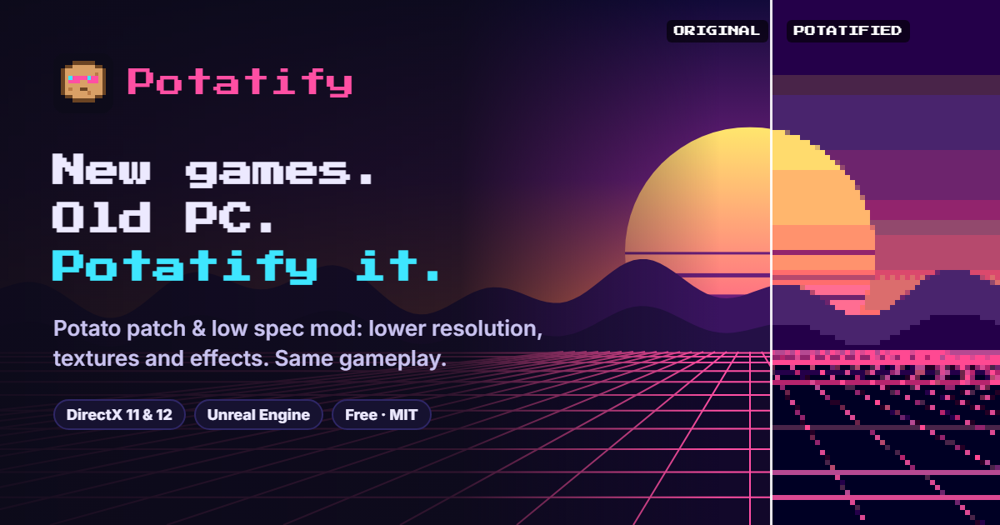

# Potatify



**Run new, heavy PC games on a potato PC.** A lite / low-spec / min-spec patch for DirectX 11 and 12 games: spec down the graphics, keep the gameplay.

[Website](https://hoanglt1223.github.io/potatify/) · [Download](https://github.com/hoanglt1223/potatify/releases/latest)

Make heavy PC games lighter by dropping a `d3d11.dll` and a `d3d12.dll` next to the game's `.exe`. The DLLs sit between the game and DirectX and rewrite graphics commands on the way through: lower 3D render resolution, smaller textures, cheaper texture filtering, and an optional retro look. Game logic is untouched, so gameplay stays the same.

## Use

1. Run `potatify.exe`, choose the folder with the game's `.exe` (for Unreal Engine games the root folder works too), pick a preset or set the options, and press **Install**.
2. Start the game. **Remove** deletes everything Potatify wrote and restores files it backed up.

| Option | DX11 | DX12 | Saves | What it does |
|---|---|---|---|---|
| 3D render resolution | yes | Unreal only | GPU time | Screen-sized render targets are created smaller; viewports follow; the game's own final pass scales the picture up |
| Texture size | yes | Unreal only | VRAM, bandwidth | Drops the top mip levels of textures the game uploads (1/2 size = 1/4 memory) |
| Texture filtering | yes | yes | GPU time | Point or plain bilinear instead of anisotropic filtering, including D3D12 static samplers |
| Pixelate screen, colours | yes | yes | nothing (look only) | Blocky pixels and a reduced palette at Present |
| Unreal Engine settings | yes | yes | GPU time | Writes a marked block to the game's `Engine.ini` (the first original is kept as `Engine.ini.potatify-backup`): screen percentage, mip bias, Lumen, virtual shadows, volumetrics, post effects off |
| Log | yes | yes | | `potatify-d3d11.log` / `potatify-d3d12.log` next to the DLL: what changed, plus fps, frame times and VRAM every 5 s |

Presets: `off` (passthrough; with the log on it measures the unmodified game), `light`, `ps2`, `ps1`, `potato`.

CLI, for scripts:

```
potatify --out <game dir> [--preset off|light|ps2|ps1|potato] [--render-scale 25-100]
          [--mip-skip 0-4] [--mip-skip-default] [--min-size N] [--sampler keep|point|bilinear]
          [--pixelate N] [--color-bits 0-8] [--api d3d11|d3d12|both] [--unreal auto|off] [--log] [--force]
potatify --read <game dir | dll>
potatify --remove <game dir>
```

How to test a game and report results: [docs/TESTING.md](docs/TESTING.md). Results go in [compat/](compat/).

## Limits

- Offline games only. Games with anti-cheat (Vanguard, EasyAntiCheat, BattlEye) may ban accounts for a foreign DLL.
- It cannot make CPU-heavy games faster or add GPU features the card lacks (mesh shaders, ray tracing, feature level 12_1).
- Render resolution scaling in DX11 breaks games that read screen-sized buffers by pixel position; if only part of the picture shows, set it back to Full. When a game copies between a scaled and a full-size buffer, Potatify stops scaling new buffers and says so in the log. DX12 games get lower resolution only through the Unreal settings.
- Vulkan and OpenGL games are not covered.

## How it works

Windows loads DLLs from the game folder before `System32`, so the proxies load first. Each one loads the real DLL from `System32`, forwards every export (`proxy/exports-*.txt` turned into MASM jump stubs by `cmake/gen-forwarders.cmake`), and patches a few COM vtable slots:

- `proxy/d3d11-proxy.c`: `CreateTexture2D` (mip skipping, smaller screen-sized targets), `CreateSamplerState`, the context's viewport, scissor and render target setters, and the swapchain's `GetBuffer`/`Present`.
- `proxy/d3d12-proxy.c`: `CreateSampler`, `CreateSampler2`, `CreateRootSignature` (static samplers), the factory's swapchain creation (to remember the command queue) and `Present`, where the post-process is recorded on the game's queue.

`potatify.exe` embeds both template DLLs as resources and patches their config block (`proxy/demake-config.h`) when it writes them into a game folder. `tool/unreal.c` finds Unreal games and edits their `Engine.ini`.

## Also known as

People look for this under many names. Potatify is a **potato patch**, **potato mode** or **potato PC mod** for games;
a **lite mode**, **low spec patch**, **min spec mod**, **spec down** or **graphics downgrade** tool; a way to
**patch a game to run on a low-end PC**, a **weak GPU**, an **integrated GPU** or a **laptop**; a
**reverse upscaler** (the opposite of DLSS and FSR); a **lower than low settings** / **ultra low graphics** mod
(including **Unreal Engine 4/5 potato settings** in Engine.ini); a **VRAM reducer** and **FPS boost** for games that run
out of video memory; and a **demake** or **retro / PS1 / pixel-art graphics** filter.

Tiếng Việt: chạy game nặng trên máy yếu, giảm cấu hình game, hạ đồ họa thấp hơn mức thấp nhất, bản patch game cho PC
cấu hình thấp, card onboard, laptop cùi, giảm VRAM, tăng FPS.

## Build and test

```
cmake -S . -B out/msvc -G "Visual Studio 17 2022" -A x64
cmake --build out/msvc --config Release
ctest --test-dir out/msvc -C Release      # headless: WARP devices, hidden windows
```
